# 🚀 LTMobile-TaskFlow: Hệ Thống Quản Lý & Tối Ưu Năng Suất Công Việc Toàn Diện

> **TaskFlow** là ứng dụng di động quản lý công việc và tối ưu năng suất cá nhân/đội ngũ phát triển trên nền tảng **Android Native (Kotlin & Jetpack Compose)**, hoạt động theo triết lý **Local-First & Offline-First** kết hợp với nền tảng điện toán đám mây **Firebase BaaS**. Ứng dụng tích hợp hệ thống đo lường thời gian tập trung Pomodoro chuyên sâu (Foreground Service), trợ lý thông minh Firebase AI Logic (Gemini 4 Hydrogen / 3.8 Flash), hệ thống Gamification vinh danh thành tích (Streak Tracker & Badges), tiện ích màn hình chính (App Widget tương tác hai chiều) cùng cơ chế bảo mật sinh trắc học vân tay và mã PIN mã hóa đa lớp.

---

## 📑 Mục Lục
- [1. Giới Thiệu Hệ Thống](#1-giới-thiệu-hệ-thống)
  - [1.1. Bối cảnh & Vấn đề thực tế](#11-bối-cảnh--vấn-đề-thực-tế)
  - [1.2. Giải pháp hệ thống TaskFlow](#12-giải-pháp-hệ-thống-taskflow)
  - [1.3. Bảng phân quyền đối tượng sử dụng](#13-bảng-phân-quyền-đối-tượng-sử-dụng)
  - [1.4. Nguyên tắc thiết kế cốt lõi](#14-nguyên-tắc-thiết-kế-cốt-lõi)
- [2. Kiến Trúc Ứng Dụng (MVVM Architecture & Data Flow)](#2-kiến-trúc-ứng-dụng-mvvm-architecture--data-flow)
  - [2.1. Mô hình MVVM & Luồng Dữ liệu Một chiều (UDF)](#21-mô-hình-mvvm--luồng-dữ-liệu-một-chiều-udf)
  - [2.2. Sơ đồ Kiến trúc Chi tiết (Architecture Diagram)](#22-sơ-đồ-kiến-trúc-chi-tiết-architecture-diagram)
- [3. Bảng Tổng Hợp Các Tính Năng Chính](#3-bảng-tổng-hợp-các-tính-năng-chính)
- [4. Danh Sách Thành Viên Nhóm](#4-danh-sách-thành-viên-nhóm)
- [5. Bảng Công Nghệ Sử Dụng (Tech Stack)](#5-bảng-công-nghệ-sử-dụng-tech-stack)
- [6. Cấu Trúc Thư Mục (Project Structure)](#6-cấu-trúc-thư-mục-project-structure)
- [7. Hướng Dẫn Cài Đặt & Cách Chạy (How to Run)](#7-hướng-dẫn-cài-đặt--cách-chạy-how-to-run)
  - [7.1. Yêu cầu môi trường](#71-yêu-cầu-môi-trường)
  - [7.2. Clone source code](#72-clone-source-code)
  - [7.3. Cấu hình biến môi trường & Firebase](#73-cấu-hình-biến-môi-trường--firebase)
  - [7.4. Khởi chạy trên Máy ảo (Emulator) & Thiết bị thật](#74-khởi-chạy-trên-máy-ảo-emulator--thiết-bị-thật)
  - [7.5. Lưu ý xử lý lỗi thường gặp (Troubleshooting)](#75-lưu-ý-xử-lý-lỗi-thường-gặp-troubleshooting)

---

## 1. Giới Thiệu Hệ Thống

### 1.1. Bối cảnh & Vấn đề thực tế
Trong học tập và làm việc hiện đại, các cá nhân và nhóm nhỏ thường xuyên đối mặt với:
- **Tình trạng quá tải công việc (Task Overload):** Thiếu công cụ phân loại mức độ ưu tiên khoa học (Low, Medium, High, Urgent), dẫn đến trễ hạn (Overdue) và suy giảm năng suất.
- **Sự phụ thuộc mạng (Network Dependency):** Đa phần ứng dụng hiện nay phụ thuộc hoàn toàn vào kết nối Internet. Khi mất mạng, người dùng không thể xem hay ghi nhận công việc kịp thời.
- **Mất tập trung & Kiệt sức (Burnout):** Thiếu cơ chế cân bằng giữa thời gian làm việc tập trung cao độ (Deep Work) và quãng nghỉ khoa học.
- **Thiếu động lực duy trì thói quen:** Không có cơ chế kích thích tâm lý (Gamification) để duy trì tính liên tục của công việc mỗi ngày.
- **Bảo mật dữ liệu cá nhân:** Cần một lớp bảo vệ độc lập (Mã PIN & Sinh trắc học) ngăn ngừa truy cập trái phép ngay cả khi thiết bị di động đã được mở khóa.

### 1.2. Giải pháp hệ thống TaskFlow
**TaskFlow** mang lại giải pháp công nghệ toàn diện giải quyết triệt để các bài toán trên:
1. **Kiến trúc Local-First & Offline-First:** Ứng dụng vận hành trơn tru 100% khi không có mạng thông qua cơ sở dữ liệu Room Database (SQLite). Khi có kết nối mạng, ứng dụng đồng bộ xác thực và sao lưu đám mây với **Firebase BaaS**.
2. **Trợ lý Ảo AI Assistant (Firebase AI Logic):** Tích hợp mô hình AI thế hệ mới `gemini-4-hydrogen` (với cơ chế dự phòng tự động `gemini-3.8-flash` và bảo mật Firebase App Check). AI có khả năng trò chuyện thông minh, khéo léo điều hướng về công việc và **trực tiếp tạo task vào Room DB** theo khẩu lệnh tự nhiên của người dùng.
3. **Đồng hồ Pomodoro Focus Service:** Vận hành thông qua Android **Foreground Service** chuyên dụng, hỗ trợ đếm giờ chuẩn xác ngầm dưới nền, phát chuông báo, rung và điều khiển trực tiếp trên thanh Notification.
4. **Hệ thống Gamification (Streak & Badges):** Tự động tính chuỗi ngày hoàn thành công việc liên tiếp (Streak Calculator). Tính năng **Streak Protection** cảnh báo bảo vệ chuỗi streak qua `AlarmManager` khi sắp hết ngày mà chưa hoàn thành việc nào. Bộ sưu tập **28 Huy hiệu thành tích** kích thích động lực hoàn thành mục tiêu.
5. **Tiện ích Màn hình chính (HomeScreen App Widget):** Widget tương tác hai chiều hiển thị danh sách việc cần làm trong ngày, chạm checkbox để hoàn thành ngay tại màn hình chính, hoặc chạm để xem chi tiết / chỉnh sửa công việc.
6. **Bảo mật Sinh trắc học & Mã PIN:** Hỗ trợ khóa ứng dụng bằng mã PIN 4-6 số mã hóa SHA-256 kèm Salt ngẫu nhiên và mở khóa tức thì bằng **Cảm biến Vân tay (BiometricPrompt)**.
7. **Sao lưu & Khôi phục Dữ liệu Chuyên sâu:** Xuất dữ liệu ra file JSON chuẩn hóa và phục hồi dữ liệu qua quy trình kiểm định 5 bước nghiêm ngặt (`BackupValidator`), hỗ trợ cả chế độ ghi đè lẫn gộp dữ liệu.

### 1.3. Bảng phân quyền đối tượng sử dụng

| Đối tượng (Role) | Mô tả vai trò | Quyền hạn trong hệ thống |
| :--- | :--- | :--- |
| **Guest / Offline User** | Người dùng trải nghiệm cục bộ không cần tài khoản | - Sử dụng đầy đủ tính năng cốt lõi Offline (CRUD Task, Pomodoro, Calendar, Badges).<br>- Lưu trữ dữ liệu an toàn trên SQLite/Room cục bộ.<br>- Đặt mã PIN & mở khóa vân tay bảo vệ ứng dụng.<br>- Xuất / nhập dữ liệu qua file JSON lưu trên bộ nhớ máy. |
| **Authenticated Member** | Người dùng đã xác thực tài khoản qua Firebase | - Kế thừa toàn bộ quyền hạn của Guest.<br>- Xác thực an toàn qua Email/Password hoặc Google Sign-In.<br>- Định danh cá nhân hóa lời chào trên Dashboard.<br>- Tương tác với Trợ lý AI Assistant (tạo task, tìm việc, nhận gợi ý năng suất).<br>- Giám sát chỉ số thống kê & đồng bộ trạng thái đám mây. |
| **Project Owner / Team Leader** | Trưởng nhóm / Người dùng quản lý tiến độ | - Toàn quyền phân loại mức độ ưu tiên (`LOW`, `MEDIUM`, `HIGH`, `URGENT`).<br>- Quản lý các công việc lặp lại định kỳ (Recurring Tasks).<br>- Theo dõi báo cáo hiệu suất, tỷ lệ hoàn thành (Completion Rate) và tổng số giờ tập trung Pomodoro theo tuần/tháng/toàn thời gian. |

### 1.4. Nguyên tắc thiết kế cốt lõi
- **Offline-First:** Trải nghiệm người dùng luôn là ưu tiên số một; mọi thao tác dữ liệu đều ghi nhận tức thì vào Room Database cục bộ trước khi đồng bộ.
- **Unidirectional Data Flow (UDF):** Luồng dữ liệu đi một chiều duy nhất: *Events đi lên ViewModel — UI State phát ra đi xuống UI*.
- **Reactive State Management:** Sử dụng Kotlin Coroutines `StateFlow` và `Flow` để phản ánh thay đổi dữ liệu thời gian thực tới giao diện Jetpack Compose.
- **Clean Architecture & Separation of Concerns:** Phân định rõ ràng trách nhiệm giữa UI, ViewModel, Repository, DAO và Services.

---

## 2. Kiến Trúc Ứng Dụng (MVVM Architecture & Data Flow)

### 2.1. Mô hình MVVM & Luồng Dữ liệu Một chiều (UDF)
Ứng dụng được thiết kế theo mô hình **Model - View - ViewModel (MVVM)** chuẩn Android Modern Architecture:
1. **View (UI Layer):** Xây dựng 100% bằng **Jetpack Compose** (kết hợp ViewBinding cho một số form đặc thù). Tầng UI chỉ quan sát `uiState` phát ra từ ViewModel và gửi các sự kiện người dùng (User Actions) lên ViewModel.
2. **ViewModel (Presentation/State Layer):** Tiếp nhận sự kiện, gọi tầng Repository xử lý nghiệp vụ, chuyển đổi dữ liệu thành các trạng thái bất biến (`UiState`) và phát ra qua `StateFlow`.
3. **Repository (Domain/Data Layer):** Đóng vai trò làm cổng kết nối duy nhất (Single Source of Truth), điều phối dữ liệu giữa Local Database (Room DAO), Background Services và Cloud Services (Firebase).
4. **Data Source Layer:** Lưu trữ dữ liệu vật lý với Room SQLite, SharedPreferences lưu cấu hình, và Firebase API.

### 2.2. Sơ đồ Kiến trúc Chi tiết (Architecture Diagram)

```mermaid
flowchart TB
    %% ────────────────────────────────────────────────────────────────────────
    %% 1. TẦNG HIỂN THỊ (UI & PRESENTATION LAYER)
    %% ────────────────────────────────────────────────────────────────────────
    subgraph UI ["1. Tầng Hiển Thị (UI & Presentation Layer)"]
        direction TB
        subgraph SCREENS ["Màn Hình & Giao Diện Jetpack Compose"]
            MainAct["MainActivity (Single Activity Host)"]
            HomeScreen["HomeScreen / HomeContent"]
            AddEditScreen["AddEditTaskActivity / CreateTaskScreen"]
            DetailScreen["TaskDetailRoute / TaskDetailContent"]
            CalendarScreen["CalendarScheduleScreen"]
            PomodoroScreen["PomodoroScreen / PomodoroSettingsScreen"]
            StatsScreen["StatsScreen"]
            StreakScreen["StreakScreen"]
            BadgesScreen["BadgesScreen"]
            PinScreen["SetPinScreen (Dialpad & Biometric)"]
            SettingsScreen["SettingsScreen"]
            BackupScreen["DataManagementScreen / RestoreTasksScreen"]
        end

        subgraph WIDGETS ["Tiện Ích Màn Hình Chính & Dialogs"]
            AppWidget["TaskWidgetProvider (HomeScreen Widget)"]
            WidgetService["TaskWidgetService (RemoteViewsFactory)"]
            AiSheet["AiAssistantBottomSheet"]
            EditDialog["TaskDetailEditDialog"]
            PomoSheet["PomodoroTaskSelectorBottomSheet"]
        end
    end

    %% ────────────────────────────────────────────────────────────────────────
    %% 2. TẦNG QUẢN LÝ TRẠNG THÁI (VIEWMODEL LAYER)
    %% ────────────────────────────────────────────────────────────────────────
    subgraph VM ["2. Tầng Quản Lý Trạng Thái (ViewModel Layer - StateFlow & UDF)"]
        direction TB
        HomeVM["HomeViewModel"]
        TaskVM["TaskViewModel / AddEditTaskViewModel"]
        DetailVM["TaskDetailViewModel"]
        CalendarVM["CalendarViewModel"]
        PomodoroVM["PomodoroViewModel"]
        StatsVM["StatsViewModel"]
        StreakVM["StreakViewModel"]
        BadgesVM["BadgesViewModel"]
        AuthVM["AuthViewModel"]
        BackupVM["BackupViewModel"]
    end

    %% ────────────────────────────────────────────────────────────────────────
    %% 3. TẦNG NGHIỆP VỤ & ĐIỀU PHỐI (REPOSITORY & SERVICES)
    %% ────────────────────────────────────────────────────────────────────────
    subgraph DOMAIN ["3. Tầng Nghiệp Vụ & Dữ Liệu (Repository & Domain Services)"]
        direction TB
        TaskRepo["TaskRepository"]
        PomoRepo["PomodoroRepository"]
        PomoSettingsRepo["PomodoroSettingsRepository"]
        AiService["FirebaseAiService (Gemini API)"]
        AiExecutor["AiActionExecutor (Direct DB Task Action)"]
        PomoService["PomodoroService (Foreground Service)"]
        PomoEngine["PomodoroTimerEngine"]
        AlarmSched["AlarmScheduler / AlarmReceiver"]
        StreakMgr["StreakProtectionManager"]
        RecurHelper["RecurrenceHelper & TaskCompletionHelper"]
        BackupMgr["BackupManager & BackupValidator"]
        PinMgr["PinManager & BiometricAuthHelper"]
        WidgetUpdater["WidgetUpdater"]
        Recovery["TaskReminderRecovery"]
    end

    %% ────────────────────────────────────────────────────────────────────────
    %% 4. TẦNG LƯU TRỮ VẬT LÝ & ĐÁM MÂY (DATA SOURCES)
    %% ────────────────────────────────────────────────────────────────────────
    subgraph DATA ["4. Tầng Nguồn Dữ Liệu (Data Sources Layer)"]
        direction TB
        subgraph ROOM ["Cơ Sở Dữ Liệu Cục Bộ (Room SQLite)"]
            AppDb["AppDatabase (v4)"]
            TaskDao["TaskDao"]
            PomoDao["PomodoroDao"]
            TaskEntity[("Entity: tasks")]
            PomoEntity[("Entity: pomodoro_sessions")]
        end

        subgraph PREFS ["Bộ Nhớ Cấu Hình Cục Bộ (SharedPreferences)"]
            StreakPrefs["taskflow_streak_prefs"]
            PinPrefs["taskflow_pin_prefs"]
            PomoPrefs["pomodoro_settings"]
        end

        subgraph CLOUD ["Nền Tảng Điện Toán Đám Mây (Firebase Cloud)"]
            FirebaseAuth["Firebase Authentication"]
            FirebaseAi["Firebase AI Logic (Gemini 4 Hydrogen / 3.8 Flash)"]
            FirebaseAppCheck["Firebase App Check Debug Provider"]
            FirebaseAnalytics["Firebase Analytics"]
        end
    end

    %% ────────────────────────────────────────────────────────────────────────
    %% LUỒNG LIÊN KẾT GIỮA CÁC TẦNG (DATA FLOW ARROWS)
    %% ────────────────────────────────────────────────────────────────────────
    SCREENS -- "User Events (Click, Input, Toggle)" --> VM
    VM -- "StateFlow / UiState (Emit to UI)" --> SCREENS

    WIDGETS -- "Broadcast / PendingIntent Actions" --> DOMAIN
    DOMAIN -- "Trigger Widget Data Invalidation" --> WidgetUpdater
    WidgetUpdater --> AppWidget

    VM --> TaskRepo
    VM --> PomoRepo
    VM --> PomoSettingsRepo
    VM --> PinMgr
    VM --> StreakMgr

    AiSheet -- "User Prompts" --> AiService
    AiService -- "Structured Actions" --> AiExecutor
    AiExecutor -- "Insert / Update / Delete Task" --> TaskDao
    AiExecutor --> AlarmSched
    AiExecutor --> WidgetUpdater

    PomodoroVM --> PomoService
    PomoService --> PomoEngine
    PomoEngine --> PomoDao

    TaskRepo --> TaskDao
    TaskRepo --> RecurHelper
    TaskRepo --> AlarmSched
    RecurHelper --> TaskCompletionHelper

    StreakVM --> StreakMgr
    StreakMgr --> AlarmSched
    StreakMgr --> StreakPrefs

    PinScreen --> PinMgr
    SettingsScreen --> PinMgr
    PinMgr --> PinPrefs

    BackupScreen --> BackupMgr
    BackupMgr --> TaskRepo

    AlarmSched --> TaskDao
    Recovery --> AlarmSched

    AppDb --> TaskDao
    AppDb --> PomoDao
    TaskDao --> TaskEntity
    PomoDao --> PomoEntity
    PomoEntity -. "Foreign Key (CASCADE)" .-> TaskEntity

    AuthVM --> FirebaseAuth
    AiService --> FirebaseAi
    AiService --> FirebaseAppCheck
```



---

## 3. Bảng Tổng Hợp Các Tính Năng Chính

| STT | Tên tính năng | Mô tả chi tiết luồng hoạt động dựa trên source code thực tế |
| :---: | :--- | :--- |
| **01** | **Xác thực Đa hình thức (Firebase Auth)** | Quản lý phiên đăng nhập qua Email/Password và Google Sign-In. Lắng nghe trạng thái đăng nhập tự động (`AuthStateListener`) trong `HomeViewModel` để hiển thị lời chào cá nhân hóa theo tên người dùng. |
| **02** | **Bảo mật Sinh trắc học & Khóa PIN** | Khởi tạo qua `PinManager`. Khi khởi chạy app, `TaskFlowApp` kiểm tra trạng thái khóa (`isAppLocked`). Người dùng mở khóa nhanh bằng cảm biến vân tay qua `BiometricAuthHelper` hoặc nhập mã PIN 4-6 số được mã hóa SHA-256 kèm Salt ngẫu nhiên. |
| **03** | **Quản lý Vòng đời Công việc (CRUD)** | Tạo, đọc, cập nhật và xóa công việc vào bảng `tasks` trong Room DB. Hỗ trợ 4 mức độ ưu tiên (`LOW`, `MEDIUM`, `HIGH`, `URGENT`), phân loại trạng thái (`TODO`, `IN_PROGRESS`, `COMPLETED`, `OVERDUE`) với giao diện thẻ Material 3 hiện đại. |
| **04** | **Xử lý Công việc Lặp lại (Recurring Logic)** | Quản lý bởi `RecurrenceHelper` & `TaskCompletionHelper`. Hỗ trợ chu kỳ Daily, Weekly, Monthly, Yearly. Khi hoàn thành task lặp, hệ thống tự động kiểm tra giới hạn lặp (`repeatLimitCount`, `repeatEndDate`) để tự sinh ra công việc kỳ hạn tiếp theo; khi mở lại (reopen) thì tự thu hồi instance tương lai. |
| **05** | **Nhắc nhở & Báo thức (Alarm Manager)** | `AlarmScheduler` tính toán thời gian nhắc nhở chính xác theo phút trước giờ hẹn (`reminderMinutes`). Tự động khôi phục lại toàn bộ lịch hẹn sau khi điện thoại reboot hoặc đổi múi giờ thông qua `BootReceiver`, `TimeChangeReceiver` và `TaskReminderRecovery`. |
| **06** | **Trợ lý Ảo AI Assistant (Firebase AI Logic)** | Tích hợp trong `FirebaseAiService` sử dụng model `gemini-4-hydrogen` (với fallback tự động sang `gemini-3.8-flash`) và App Check. Khi người dùng yêu cầu bằng ngôn ngữ tự nhiên (VD: *"Tạo task học AI lúc 14:00 thứ 6"*), `AiActionExecutor` sẽ bóc tách JSON action và **trực tiếp ghi task vào Room DB**, lập lịch chuông và cập nhật Widget tức thì. |
| **07** | **Đồng hồ Pomodoro Tập trung (Foreground Service)** | Vận hành bởi `PomodoroService` (loại `specialUse`) độc lập với vòng đời UI. Quản lý trạng thái FOCUS, SHORT BREAK, LONG BREAK; phát chuông báo `ToneGenerator`, rung và lưu vết lịch sử phiên vào bảng `pomodoro_sessions` để phục vụ thống kê. |
| **08** | **Thống kê Năng suất Chuyên sâu (Stats)** | `StatsViewModel` tổng hợp dữ liệu thực từ `taskDao` và `pomodoroDao` theo 3 mốc thời gian (*This Week*, *This Month*, *All Time*). Biểu diễn tỷ lệ hoàn thành (`CircularCompletionRateView`) và biểu đồ năng suất theo ngày (`WeeklyProductivityChartView`). |
| **09** | **Chuỗi Streak & Bảo vệ Streak (Streak Protection)** | `StreakCalculator` tính toán chuỗi ngày liên tiếp hoàn thành việc. Tính năng **Streak Protection** lưu giờ nhắc vào `SharedPreferences` bằng `commit()` đồng bộ; đúng giờ hẹn, `AlarmReceiver` kiểm tra nếu người dùng đang có streak mà hôm nay chưa hoàn thành việc nào sẽ tự động bắn Notification nhắc nhở. |
| **10** | **Hệ thống 28 Huy hiệu Thành tích (Badges)** | `BadgesViewModel` tính toán và tự động mở khóa 28 huy hiệu chia làm 4 nhóm: *Streak Badges* (3 đến 365 ngày), *Task Completion Badges* (10 đến 1000 tasks), *Speed Badges* (hoàn thành trước 12:00 trưa), *Priority Badges* (hoàn thành việc High/Urgent). |
| **11** | **Lịch biểu Trực quan (Calendar Schedule)** | `CalendarViewModel` biểu diễn lịch tháng và danh sách công việc theo từng ngày cụ thể, tự động nhận diện múi giờ hệ thống `ZoneId.systemDefault()` và làm mới trạng thái qua đêm. |
| **12** | **Tiện ích Màn hình chính (HomeScreen Widget)** | Cung cấp widget danh sách công việc `TaskWidgetProvider` sử dụng `RemoteViewsService`. Cho phép đánh dấu hoàn thành trực tiếp bằng checkbox, chạm để mở chi tiết công việc hoặc bấm nút "+" để mở màn hình thêm việc mới. |
| **13** | **Sao lưu & Khôi phục Dữ liệu (Backup & Restore)** | `BackupManager` xuất dữ liệu ra file JSON vào bộ nhớ thiết bị. Quy trình khôi phục được bảo vệ bởi `BackupValidator` (5 bước kiểm tra: cú pháp, schema, version, task constraints, status/priority) với 2 chế độ: Gộp dữ liệu (Merge) hoặc Ghi đè (Replace). |

---

## 4. Danh Sách Thành Viên Nhóm

| STT | Họ và Tên | Mã Số Sinh Viên | Vai Trò Đảm Nhiệm |
| :---: | :--- | :---: | :--- |
| **1** | **Trần Phát Tài** | `086206011804` | **Team Leader** & Full-stack Mobile Dev |
| **2** | **Nguyễn Quốc Thái** | `087206004822` | **Core Member** & QA / Mobile Developer |

---

## 5. Bảng Công Nghệ Sử Dụng (Tech Stack)

| Phân loại | Công nghệ / Thư viện | Phiên bản | Mục đích sử dụng |
| :--- | :--- | :---: | :--- |
| **Ngôn ngữ & Nền tảng** | **Kotlin** | `2.1.10` | Ngôn ngữ phát triển chính cho toàn bộ ứng dụng |
| | **Android SDK** | Min 26 / Target 35 | Tương thích từ Android 8.0 Oreo đến Android 15 Vanilla Ice Cream |
| | **Java Compatibility** | JDK 17 | Nền tảng JVM tiêu chuẩn hỗ trợ build hiện đại |
| **Giao diện & UI Tooling** | **Jetpack Compose BOM** | `2024.10.01` | Bộ công cụ xây dựng giao diện khai báo hiện đại (Declarative UI) |
| | **Material Design 3** | BOM | Thư viện thiết kế chuẩn Material You của Google |
| | **Material Icons Extended** | BOM | Hệ thống icon Material mở rộng |
| | **Navigation Compose** | `2.8.9` | Điều hướng Single Activity SPA giữa các Composable Screens |
| **Kiến trúc & Bất đồng bộ** | **Lifecycle & ViewModel Compose** | `2.8.7` | Quản lý vòng đời màn hình và StateFlow theo mô hình MVVM/UDF |
| | **Kotlinx Coroutines** | `1.8.1` | Xử lý các tác vụ bất đồng bộ đa luồng (Dispatchers.IO, Main, Default) |
| **Cơ sở dữ liệu Cục bộ** | **Room Database (SQLite)** | `2.6.1` | Hệ thống ORM quản lý dữ liệu cục bộ an toàn kiểu (Type-safe) |
| | **Kotlin Symbol Processing (KSP)** | `2.1.10-1.0.30` | Trình biên dịch mã nguồn sinh tự động cho Room DAO |
| | **Google Gson** | `2.10.1` | Parse / Serialize JSON phục vụ Sao lưu & Phục hồi dữ liệu |
| **Bảo mật & Xác thực** | **AndroidX Biometric** | `1.2.0-alpha05` | Xác thực sinh trắc học vân tay an toàn bằng phần cứng |
| | **Firebase Authentication** | BoM `34.0.0` | Quản lý tài khoản người dùng (Email/Password & Google OAuth) |
| | **Play Services Auth** | `21.2.0` | Hỗ trợ Google Sign-In một chạm |
| **Trí Tuệ Nhân Tạo & Cloud** | **Firebase AI Logic (`firebase-ai`)** | BoM `34.0.0` | Tích hợp mô hình Gemini (`gemini-4-hydrogen`, `gemini-3.8-flash`) |
| | **Firebase App Check Debug** | BoM `34.0.0` | Bảo vệ tài nguyên Firebase Backend chống lạm dụng |
| | **Firebase Analytics & Database** | BoM `34.0.0` | Giám sát đo lường hành vi và đồng bộ dữ liệu |
| **Tác vụ Nền & Tiện ích** | **Foreground Service** | Android 14+ | Duy trì bộ đếm thời gian Pomodoro không gián đoạn |
| | **AlarmManager & Receivers** | Android SDK | Hẹn giờ chính xác cho nhắc việc và Streak Protection |
| | **AppWidgetProvider** | Android SDK | Cung cấp tiện ích danh sách công việc trên màn hình chính |
| **Kiểm thử (Testing)** | **JUnit 4** | `4.13.2` | Bộ framework chạy Unit test |
| | **Coroutines Test** | `1.8.1` | Kiểm thử luồng Coroutine & Flow bất đồng bộ |
| | **AndroidX Core Testing** | `2.2.0` | Hỗ trợ InstantTaskExecutorRule cho Architecture Components |

---

## 6. Cấu Trúc Thư Mục (Project Structure)

```text
LTMobile-TaskFlow/
├── Code/                                       # Thư mục gốc chứa dự án Android
│   ├── app/                                    # Module ứng dụng Android chính
│   │   ├── google-services.json                # Cấu hình kết nối Firebase BaaS (Project ID: taskflow-a9903)
│   │   ├── proguard-rules.pro                  # Quy tắc tối ưu và bảo vệ mã nguồn ProGuard/R8
│   │   ├── build.gradle.kts                    # Cấu hình build, plugins, dependencies của module app
│   │   └── src/
│   │       ├── main/
│   │       │   ├── AndroidManifest.xml         # File Manifest định nghĩa quyền hạn, Activities, Services, Receivers
│   │       │   ├── java/com/team/taskmanagementapp/
│   │       │   │   ├── MainActivity.kt         # Single Activity điều phối giao diện Jetpack Compose SPA
│   │       │   │   ├── TaskApplication.kt      # Class Application khởi tạo Firebase, Alarms và phục hồi nhắc nhở
│   │       │   │   ├── ai/                     # Module Trí tuệ nhân tạo (Firebase AI Logic)
│   │       │   │   │   ├── FirebaseAiService.kt      # Kết nối Gemini 4 Hydrogen / 3.8 Flash, quản lý prompt
│   │       │   │   │   ├── AiActionExecutor.kt       # Bóc tách JSON action và trực tiếp CRUD Task vào Room DB
│   │       │   │   │   └── AiChatHistoryManager.kt   # Lưu trữ và nạp lịch sử trò chuyện AI
│   │       │   │   ├── data/                   # Tầng Quản lý Dữ liệu (Room & Repositories)
│   │       │   │   │   ├── local/
│   │       │   │   │   │   ├── dao/                  # Data Access Objects (TaskDao, PomodoroDao)
│   │       │   │   │   │   ├── db/                   # Room Database (AppDatabase, TypeConverters, Migrations)
│   │       │   │   │   │   └── entity/               # Room Entities (Task, PomodoroSession)
│   │       │   │   │   ├── model/                # Data Models & Enums (Priority, TaskStatus, RecurrenceType...)
│   │       │   │   │   ├── repository/           # Tầng Repository (TaskRepository, PomodoroRepository...)
│   │       │   │   │   └── validator/            # Trình kiểm định sao lưu dữ liệu (BackupValidator 5 bước)
│   │       │   │   ├── pomodoro/               # Module Đồng hồ Pomodoro Focus
│   │       │   │   │   ├── PomodoroService.kt        # Foreground Service chạy ngầm độc lập
│   │       │   │   │   ├── PomodoroTimerEngine.kt    # Động cơ đếm giờ chính xác mili-giây
│   │       │   │   │   └── PomodoroSnapshot.kt       # Mô hình trạng thái đếm giờ
│   │       │   │   ├── receiver/               # Bộ thu tín hiệu hệ thống BroadcastReceiver
│   │       │   │   │   ├── AlarmReceiver.kt          # Bắn thông báo nhắc task & Streak Protection khi chuông reo
│   │       │   │   │   ├── BootReceiver.kt           # Nhận tín hiệu khởi động lại máy BOOT_COMPLETED
│   │       │   │   │   └── TimeChangeReceiver.kt     # Nhận tín hiệu đổi giờ / đổi múi giờ hệ thống
│   │       │   │   ├── ui/                     # Tầng Giao diện Jetpack Compose & ViewModels
│   │       │   │   │   ├── TaskFlowApp.kt            # Điều phối điều hướng chính (Scaffold, BottomBar, DeepLinks)
│   │       │   │   │   ├── AiAssistantBottomSheet.kt # Giao diện BottomSheet chat với AI Assistant
│   │       │   │   │   ├── activity/                 # AddEditTaskActivity (Màn hình form tạo/sửa việc)
│   │       │   │   │   ├── auth/                     # Màn hình Đăng nhập / Đăng ký (AuthScreen, AuthViewModel)
│   │       │   │   │   ├── badges/                   # Màn hình 28 Huy hiệu (BadgesScreen, BadgesViewModel)
│   │       │   │   │   ├── calendar/                 # Màn hình Lịch biểu (CalendarScreen, CalendarViewModel)
│   │       │   │   │   ├── data/                     # Màn hình Xuất/Nhập dữ liệu (DataManagement, RestoreTasks)
│   │       │   │   │   ├── detail/                   # Màn hình Chi tiết công việc (TaskDetailRoute, ViewModel)
│   │       │   │   │   ├── home/                     # Màn hình Home Dashboard (HomeScreen, HomeViewModel)
│   │       │   │   │   ├── pin/                      # Màn hình Nhập & Đặt mã PIN (SetPinScreen)
│   │       │   │   │   ├── pomodoro/                 # Màn hình Pomodoro Focus & Cài đặt thời lượng
│   │       │   │   │   ├── settings/                 # Màn hình Cài đặt hệ thống (SettingsScreen)
│   │       │   │   │   ├── stats/                    # Màn hình Thống kê năng suất (StatsScreen, ViewModel)
│   │       │   │   │   ├── streak/                   # Màn hình Chuỗi ngày Streak (StreakScreen, ViewModel)
│   │       │   │   │   └── theme/                    # Cấu hình màu sắc, kiểu chữ Material Design 3
│   │       │   │   ├── util/                   # Các tiện ích bổ trợ hệ thống
│   │       │   │   │   ├── AlarmScheduler.kt         # Lập lịch chuông báo thức qua Android AlarmManager
│   │       │   │   │   ├── BackupManager.kt          # Xuất/Nhập file JSON sao lưu
│   │       │   │   │   ├── BiometricAuthHelper.kt    # Quản lý xác thực sinh trắc học vân tay
│   │       │   │   │   ├── NotificationHelper.kt     # Tạo kênh thông báo (NotificationChannel) & gửi thông báo
│   │       │   │   │   ├── PinManager.kt             # Quản lý băm SHA-256 mã PIN và lưu trữ SharedPreferences
│   │       │   │   │   ├── RecurrenceHelper.kt       # Tính toán chu kỳ lặp lại cho công việc
│   │       │   │   │   ├── StreakCalculator.kt       # Thuật toán tính chuỗi ngày Streak liên tiếp
│   │       │   │   │   ├── StreakProtectionManager.kt# Lưu giờ và lên lịch bảo vệ Streak
│   │       │   │   │   └── TaskReminderRecovery.kt   # Tự động lập lịch lại toàn bộ nhắc nhở sau khi reboot
│   │       │   │   └── widget/                 # HomeScreen App Widget
│   │       │   │       ├── TaskWidgetProvider.kt     # AppWidgetProvider xử lý sự kiện tương tác trên Widget
│   │       │   │       ├── TaskWidgetService.kt      # RemoteViewsFactory cung cấp dữ liệu danh sách task
│   │       │   │       └── WidgetUpdater.kt          # Bắn tín hiệu làm mới Widget khi DB có thay đổi
│   │       │   └── res/                        # Tài nguyên ứng dụng (Drawables, Layouts, Strings, XMLs)
│   │       └── test/java/com/team/taskmanagementapp/ # Hệ thống kiểm thử tự động Unit Tests
│   ├── gradle/
│   │   └── libs.versions.toml                  # Version Catalog quản lý tập trung toàn bộ thư viện & phiên bản
│   ├── build.gradle.kts                        # Cấu hình Gradle root
│   ├── settings.gradle.kts                     # Cấu hình repositories và modules của dự án
│   └── gradlew.bat / gradlew                   # Gradle Wrapper thực thi build đa nền tảng
└── README.md                                   # Tài liệu kỹ thuật chi tiết của dự án TaskFlow
```

---

## 7. Hướng Dẫn Cài Đặt & Cách Chạy (How to Run)

### 7.1. Yêu cầu môi trường
Trước khi bắt đầu, hãy đảm bảo máy tính của bạn đã cài đặt các công cụ sau:
- **Hệ điều hành:** Windows 10/11, macOS (Intel hoặc Apple Silicon M1/M2/M3), hoặc Linux (Ubuntu 20.04+).
- **Java Development Kit (JDK):** **JDK 17** (Khuyên dùng Eclipse Temurin 17 hoặc Amazon Corretto 17).
- **Android Studio:** Phiên bản **Android Studio Ladybug (2024.2.1+)** hoặc **Koala** trở lên.
- **Android SDK:**
  - `compileSdk`: **35** (Android 15)
  - `targetSdk`: **35**
  - `minSdk`: **26** (Android 8.0 Oreo trở lên)
  - Cài đặt đầy đủ: Android SDK Build-Tools 35.0.0, Android SDK Platform 35.

### 7.2. Clone source code
Mở Terminal hoặc PowerShell và chạy câu lệnh sau:
```bash
# Clone source code từ GitHub repository chính thức
git clone https://github.com/phattai-gif/LTMobile-TaskFlow.git

# Điều hướng vào thư mục dự án
cd LTMobile-TaskFlow/Code
```

### 7.3. Cấu hình biến môi trường & Firebase
1. **Mở dự án trong Android Studio:**
   - Khởi động Android Studio > Chọn **Open**.
   - Trỏ đường dẫn đến thư mục `LTMobile-TaskFlow/Code` (nơi chứa file `settings.gradle.kts`) và bấm **OK**.
   - Đợi Android Studio hoàn tất quá trình **Gradle Sync** và tải các dependencies.

2. **File cấu hình Firebase (`google-services.json`):**
   - File cấu hình `google-services.json` chuẩn của dự án đã được tích hợp sẵn tại đường dẫn: `Code/app/google-services.json` kết nối với Firebase Project `taskflow-a9903`.
   - Nếu bạn muốn dùng Firebase Project riêng của mình: Tải file `google-services.json` từ Firebase Console và ghi đè vào thư mục `Code/app/`.

3. **Cấu hình `local.properties`:**
   - Đảm bảo file `Code/local.properties` trỏ đúng đường dẫn thư mục Android SDK trên máy của bạn:
     ```properties
     sdk.dir=C\:\\Users\\<Your-Username>\\AppData\\Local\\Android\\Sdk
     ```

### 7.4. Khởi chạy trên Máy ảo (Emulator) & Thiết bị thật

#### Cách 1: Khởi chạy trên Máy ảo (Android Emulator)
1. Trong Android Studio, mở **Device Manager** (Tools > Device Manager).
2. Tạo một máy ảo Android Virtual Device (AVD):
   - **Device Definition:** Pixel 7 / Pixel 8 / Pixel 9.
   - **System Image:** Android 14 (API 34) hoặc Android 15 (API 35) (Google Play System Image).
3. Khởi động máy ảo.
4. Trên thanh công cụ Android Studio, chọn thiết bị máy ảo vừa bật và bấm nút **Run 'app' (Shift + F10)**.

#### Cách 2: Khởi chạy trên Thiết bị thật (Physical Device)
1. Trên điện thoại Android (Android 8.0+):
   - Vào **Cài đặt > Thông tin điện thoại > Chạm 7 lần vào "Số hiệu bản dựng" (Build Number)** để mở khóa *Tùy chọn cho nhà phát triển (Developer Options)*.
   - Vào **Tùy chọn cho nhà phát triển > Bật "Gỡ lỗi USB" (USB Debugging)**.
2. Kết nối điện thoại với máy tính qua cáp USB (chọn xác nhận *Allow USB Debugging* trên màn hình điện thoại) hoặc dùng tính năng **Pair Devices Using Wi-Fi** trên Android Studio.
3. Chọn tên thiết bị thật của bạn trên Android Studio và bấm **Run 'app' (Shift + F10)**.

#### Cách 3: Biên dịch qua dòng lệnh (CLI Gradle)
Nếu muốn build file APK cài đặt trực tiếp:
```bash
# Trên Windows (PowerShell / CMD):
cd Code
gradlew.bat assembleDebug

# Trên macOS / Linux:
cd Code
./gradlew assembleDebug
```
File APK đầu ra sẽ được tạo tại: `Code/app/build/outputs/apk/debug/app-debug.apk`. Cài đặt vào máy bằng câu lệnh:
```bash
adb install -r Code/app/build/outputs/apk/debug/app-debug.apk
```

### 7.5. Lưu ý xử lý lỗi thường gặp (Troubleshooting)

| Lỗi thường gặp | Nguyên nhân | Cách khắc phục |
| :--- | :--- | :--- |
| `JDK version incompatible` hoặc `Unsupported class file major version` | Android Studio đang trỏ sai phiên bản Java (dưới Java 17). | Vào **Settings (Preferences) > Build, Execution, Deployment > Build Tools > Gradle**. Tại mục **Gradle JDK**, chọn đúng **JDK 17**. |
| `Access is denied / index.lock` khi chạy lệnh Git trên Windows | Windows OneDrive đồng bộ giữ file lock của thư mục `.git`. | Tạm dừng đồng bộ OneDrive cho thư mục chứa code, hoặc xóa file `.git/index.lock` nếu có. |
| Không nhận thông báo nhắc việc hoặc Streak Protection | Ứng dụng chưa được cấp quyền Notification trên Android 13+ (API 33+). | Vào màn hình **Settings** trong app > Bấm vào dòng thông báo hệ thống, hoặc vào Cài đặt máy > Ứng dụng > TaskFlow > **Bật Cho phép Thông báo (Allow Notifications)**. |
| Không mở khóa được bằng Vân tay trên Emulator | Máy ảo chưa thiết lập vân tay giả lập. | Trong máy ảo: Vào **Settings > Security > Fingerprint**, thiết lập mã PIN và vân tay. Trong cửa sổ điều khiển máy ảo (Extended Controls `...`) > Chọn **Fingerprint** > Bấm **Touch the sensor** để mô phỏng chạm vân tay. |

---
*© 2026 LTMobile-TaskFlow Team. Tài liệu dự án được xây dựng và duy trì bởi Trần Phát Tài & Nguyễn Quốc Thái.*
